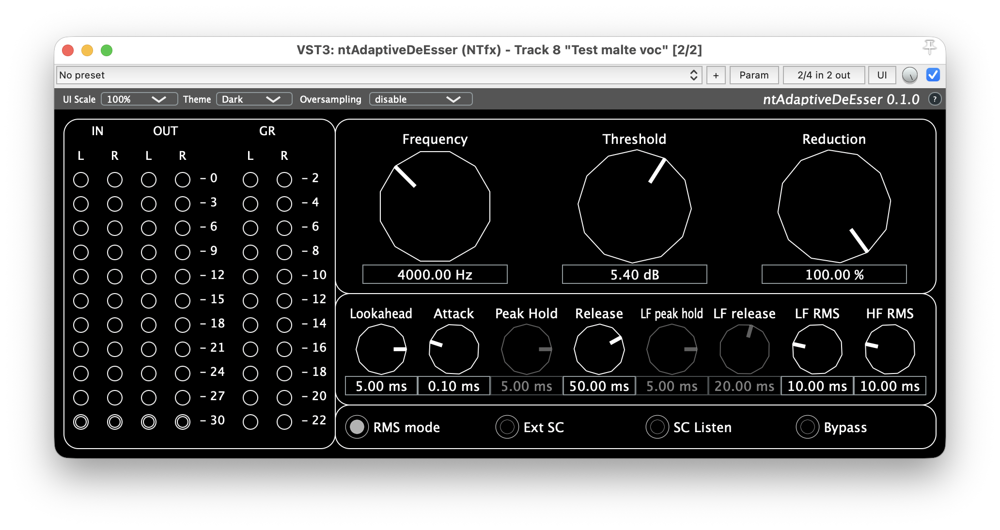

# ntAdaptiveDeEsser manual

ntAdaptiveDeEsser is a deesser with automatic threshold. This manual describes
the "white version" of the plugin with all the underlying paramters available.
Some of these will be locked down or linked to others for simplified operation
at a later time.

This plugin uses a fourth order crossover to split the signal in a high and low
frequency protion and compare the two in order to determine when an es occurs on
the input. The output of this comparison is fed to a compressor side chain,
which calculates the gain reduction, which controls the level of a second order
high shelving filter. Selectable peak or RMS sensors are available.

## Toggles

### RMS mode

Chooses RMS sensors in HF/LF comparison and compressor side chain as opposed to
peak hold sensors.

### Ext SC

Chooses the external side chain input of the plugin for the side chain.

### SC Listen

Routes the high frequency portion of the side chain input to the output.

### Auto

The Auto mode links the parameters so all time constants regarding the attack
follow the lookahead.

### Bypass

You will never guess what the does.

## Primary Controls

### Frequency

This parameter controls the crossover frequency of the sensor and the poles of
the shelving filter.

### Threshold

Adds/subtracts an offset to/from the adaptive threshold the algorithm has
estimated.

### Reduction

Like a ratio on a compressor, this parameter can be used to reduce the amount of
reduction.

## Secondary Controls

### Lookahead

This parameter delays the output signal compared to the side chain, allowing for
_pre-attack_, so the attack phase of the gain reduction can be completed once
the es occurs. Should be set to a value close to the attack time to achieve this
effect.

### Attack

Attack for the high frequency gain reduction. If **RMS mode** is selected, this
will be less dominalt until the value is larger that half the RMS averaging
time.

### Peak Hold

When the plugin is used in peak sensing mode this controls for how long the peak
level of the HF portion of the signal is held before comparison of high and low
frequency signal level. Can be used along with **attack** and **lookahead** to
make sure the attack reaches the full reduction when the es occurs.

### Release

Release for the high frequency gain reduction.

### LF peak hold

When used in peak sensing mode, the sensor "remembers" the last peak level of
the signal for the duration set by this parameter. This will is a low level
parameter that affects the comparison between high and low frequency content.
Too short, and the high protion of the signal will be estimated too high, too
long, and the low frequency portion will dominate too much.

### LF Release

Similar to **LF peak hold**, this parameter controls the smoothing on the LF
peak sensor. Increasing it will make the operation less erratic, but also less
responsive changes to the input.

### LF RMS

RMS averaging time in the low frequencies. Only active in **RMS mode**. Setting
this to a value different to the HF RMS time constant make things strange.
Comparing signal level at different time constants is a bit like comparing
apples and pears.

### HF RMS

RMS averaging time in the high frequencies. Only active in **RMS mode**.
