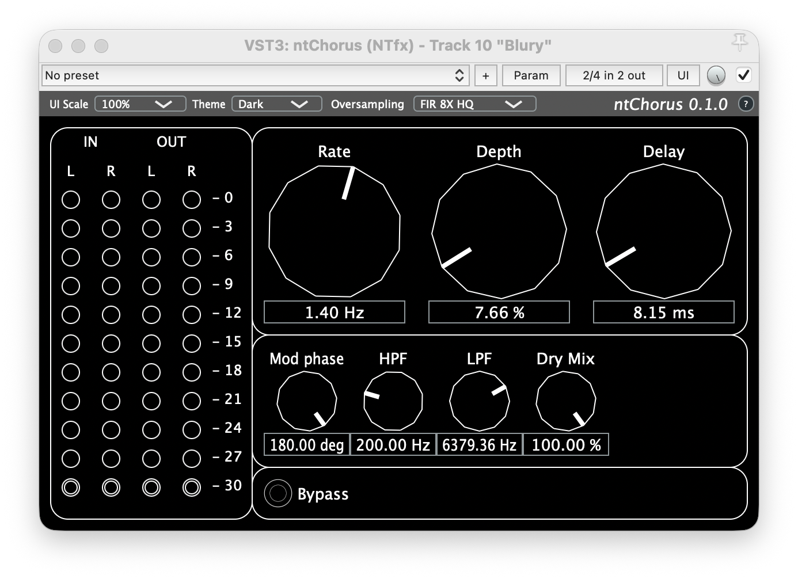

# ntChorus Manual

ntChorus is a classic chorus effect using intersample delay modulation. A
user-controllable wet delay lets you use it more in as a phaser by setting to 0
or an audible delay effect by increasing the value. High and low pass filters
are first order and can be used to make the effect less obvious while a phase
control inserts an offset between left and right channel in order to increase
the stereo spread.
