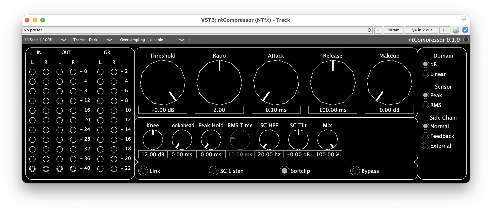

# ntCompressor Manual

This document describes the use of the ntCompressor plugin. The plugin is a
standand audio compressor with some extra features, including variable lookahead
with peak hold, selectable processing domain and sensor type.

## Primary controls

The plugin has the following primary controls.

### Threshold

Controls the level above which compression is active.

### Ratio

Controls the amount og gain reduction of the signal above threshold.

### Attack

Controls how fast compression takes hold.

### Release

Controls how fast the gain reduction recovers.

### Makeup

Makes up the difference.

## Secondary controls

Secondary controls are places below the primary controls.

### Knee

Controls the transition between reduction and no reduction.

### Lookahead

Delays the audio path compared to the side chain path. If set to the same value
as or above **Attack**, gain reduction will be fully engaged once the event that
caused that reduction occurs in the main audio path.

### Peak Hold

The peak sensor "remembers" the peak level for the duration of this settings. If
set to the same value or above **lookahead**, the algorithm will ensire full
gain reduction once attack expires.

### RMS Time

If **RMS Mode** is selected, this controls how long the signal is averaged over.

### SC HPF

Side chain high pass filter frequency. The filter is a 2nd order Butterworth.

### SC Tilt

Tilts the response in the side chain. Value measured in dB/decade, so full tilt
at +10 dB is -15 dB at 20 Hz and +15 at 20 kHz.

### Mix

Mixes the unaltered input with the output of the compressor. Latency is
compensated.

## Toggles

The plugin includes the following toggles.

### Link

Links left and right channels by picking the largest gain reduction.

### SC Listen

Sends the side chain signal to the output.

### Soft Clip

Enables a 5th order soft clipper on the output.

### Bypass

Bypasses the effect.

## Radio buttons

The plugin has the following radio button options the the right in the UI.

### Domain

Selects the domain in which the compression side chain is calculated. Use this
as a creative tool, since it changes how the compressor grabs the signal.

#### dB

Ideal dB domain calculation. This is the "correct" approach, and as much kinda
boring.

#### Linear

In the real world, analog compressors act in the linear domain, thus this sounds
a bit more like some old.

### Sensor

There are two sensor type to choose from in this compressor.

#### Peak

The peak sensor reacts instantly to incoming signal and adds the hold feature
for lookahead compression, or just a ton of pumping, if that's your thing.

#### RMS

RMS mode is softer, slower, and more "natural" than peak, since an RMS
measurement is closer to what analog gear does and closer to what we hear.

### Side Chain

There are three options for choosing side chain input.

#### Normal

Feed forward, as any moden compressor, selects the audio input as the side chain
input.

#### Feedback

Chooses the output of the compression, pre makeup, soft clip and mix for side
chain input. This is what the classic, vintage compressors, we all love, do.
Corrected for lookahead.

## Meters

Three stereo meters are available.

### IN

Measures the input level.

### OUT

Measures the output level.

### GR

Displays the current gain reduction.
