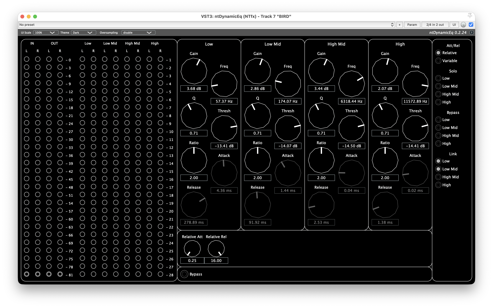

# ntDynamicEq Manual

ntDynamicEq is a four band parallel, dynamic EQ with full compressor controls
for all bands and relative attack and release times. All bands are bell shape
the side chain operates in the linear domain and has a fixed 12 dB knee.

## Controls

Each band has EQ controls:

- **Gain** controls the level og the EQ band post compression.
- **Freq** Controls the center frequency of the band.
- **Q** Controls the width of the band. Higher values means a narrower band.

The well known compressor controls are placed below the EQ controls for each
band:

- **Threshold** controls the level at which compression sets in for each band.
- **Ratio** controls the amount of the level above **Threshold** is being
  reduced.
- **Attack** controls how fast the compressor applies gain reduction.
- **Release** controls how fast the compressor recovers after the signal falls
  below **Threshold**.

### Relative Attack And Release

In the right top corner of the UI is a pair of radio buttons labled **Att/Rel**.
These control attack and release mode. When attack and release mode is set to
**Relative**, attack and release times in the UI are disabled, and the time
constants are set relative to the frequency setting for each band. When set to
**Variable**, the compressors in each band operate independantly.

Below the four bands are the controls for the relative attack and release.

- **Relative Att** is a multiplier on the attack time for all bands, allowing
  settings from 1/4 to 4 times the wave time for the selected center frequency.
- **Relative Rel** is a multiplier on the release time for all bands, allowing
  settings from 1 to 16 times the wave time for the selected center frequency.

### Bandwise Toggles

To the right of the UI is placed a number of toggles for each band. These
include:

- **Solo** mute the other bands and the parallel path so one or more band can be
  heard in isolation. If all bands are soloed, the parallel path remains muted,
  thus this it not the same as disabling all solos.
- **Bypass** disables the selected bands.
- **Link** Stereo links left and right channel for the selected bands.
