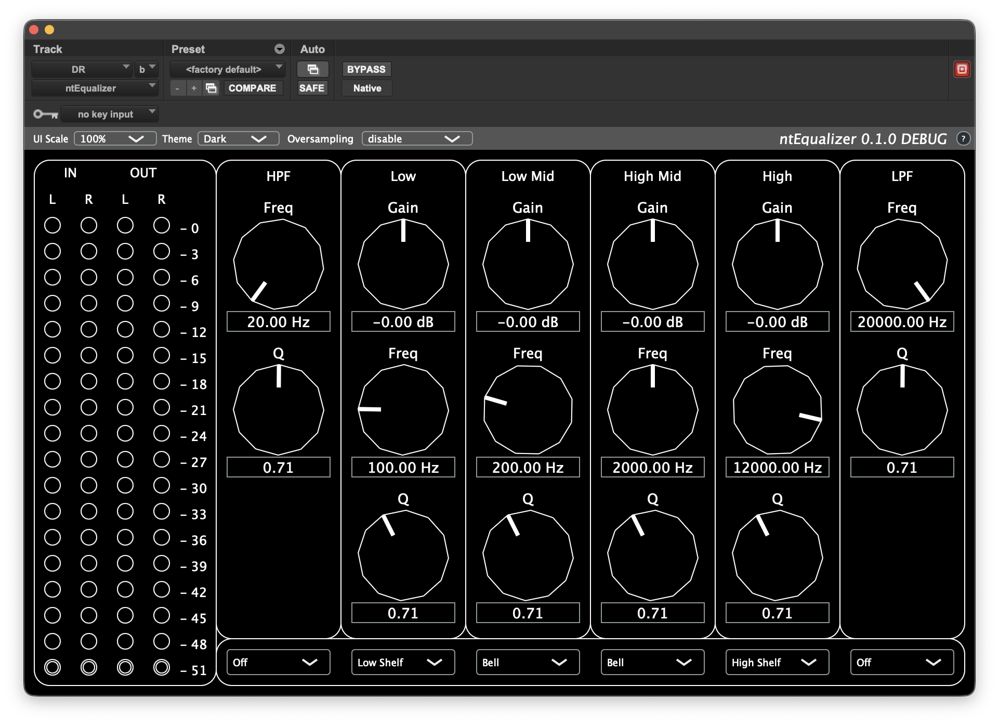

# ntEqualizer Manual

The ntEqualizer is a classic EQ plugin using a biquad cascade to implements
high- and low pass filters along with bell, band pass and all pass filters.
There is in other words nothing special about this plugin. Well besides to the
user controller Q on high and low pass filters.

## HPF and LPF

The first and last band from the left are the high- and low pass filter. First
to fourth order filters are available and the Q is user controllable all except
first order. Setting the Q to 0.707 produces a Butterworth filter, while a lower
Q will make it more dampened and thus provide a softer knee to the filter and a
Q above 0.707 will produce a resonant bump at the resonance frequency of the
filter.

## Remaining bands

The four remaining bands are all second order filters and have user variable
shape. The available shapes are selected using the drop downs below each band's
controls.

- **Bell** provides a classic bell shaped EQ band.
- **High Shelf** Controls the level of the frequencies above the selected
  frequency.
- **Low Shelf** Controls the level of the frequencies below the selected
  frequency.
- **Notch** Removes the selected frequency completely.
- **High Pass** In case you need even more high pass.
- **Low Pass** Same.
- **All Pass** Doesn't change the magnitude response of the signal, but flips
  the phase at the selected frequency. Good for phase matching multible signals
  where a classis phase flip doesn't do the trick.
- **Band Pass** Isolated the selected frequency. Mostly useful for parallel
  processing.
- **Off** Disables the filter.
