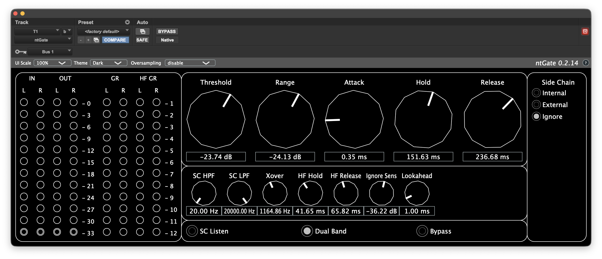

# ntGate Manual

A noise gate with exponential attack, linear dual channel release and advanced
side chain control features.

The top row in controls are the expected **Threshold**, **Range**, **Attack**,
**Hold** and **Release** settings for the gate. To the right, the **Side Chain**
mode is selected and below is the row of advanced controls.

## Lookahead

The **Lookahead** control adds a delay to the audio path to the output
respectively to the gate side chain. This will make the gate open before the
event the triggered the opening and thus perserve attack fidelity and allow
longer attack times for smoother operation.

## Side Chain Controls

The side chain has three modes, which can be selected on the right of of UI.

- **Internal** is normal gate operation, using the main input as source for the
  side chain.
- **External** selects the key input for the side chain source.
- **Ingore** Mode requires some explanation.

### Ingore Mode

When the **Ingore** **Side Chain** mode is selected, the external key input is
feeding a compressor side chain. The compressor controls level of the signal
from the main input, feeding the gate side chain. Thus, the key input is used to
duck the level that the gate hears, making the gate less prone to opening when
signal on the key input is high. The compressor settings are tuned with drums in
mind. Using a 10 ms peak hold, the gate side chain signal will remain at this
level while the key signal event hits the main input because 10 ms is
approximately 3 meters of distance and the microphones can be expected to be
within that distance. **Ignore Sens** is threshold for the compressor and thus
it controls the amount of gain reduction.

The use case for this is drums. Feeding the snare top mic to the tom mic key
inputs and enabling **Ignore** will allow lower gate thresholds. Listening to
the side chain by enabling **SC Listen**, one should hear the snare drum
effectively disappear from the side chain signal, not a hole where it should be.

### Filters

In the bottom row of controls sit **SC HPF** and **SC LPF**. These control the
cutoff frequency of second order high and low pass Butterworth filters on the
gate side chain signal, irrespectively of mode setting.

## Dual Band Mode

When the **Dual Band** toggle is enabled, separate **HF Hold** and **HF
Release** times for the high frequencies become available along with an
**Xover** control. The attack remains the same for both bands, and a shelving
filter is used to reduce high frequencies first and let the low end sustain.This
is very useful for reducing cymbal bleed in drum mics without loosing that
sustain. **Xover** controls the corner frequency of the shelving filter. The
filter is shaped so that when the high frequency portion of the signal is
reduced fully, it forms a second order Butterworth low pass filter at the
**Xover** frequency.
