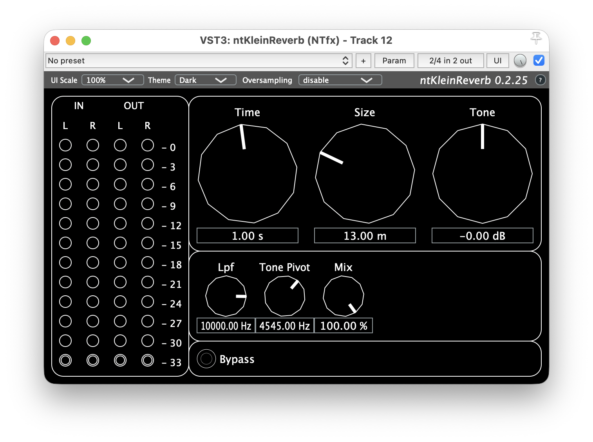

# ntKleinReverb Manual

the ntKleinReverb is a small, simple mono reverb plugin inspired by Moritz
Klein's analog eurorack reverb, which is described
[in this youtube video](https://www.youtube.com/watch?v=Nat7S3OKDV0).

It consists of two delay lines with a relationship between delay times according
to the golden ratio. These both feed back into each other with one of the feeds
in reverse phase.

This plugin does not employ analog modelling. it's only the same fitlers/block
in a digital implementation, so the graininess of the bucket brigades of the
original device is not modeled, nor are the nonlinearities of the transistors.

## Controls

The image above displays the UI of the plugin. The three main controls are:

- **Time** controls the decay time from 0.1 to 2 seconds.
- **Size** controls the delay time of the two delay lines in meters. This is the
  delay time of the longest of the two, with the shorter one getting a delay
  time 1.61 times smaller.
- **Tone** I a modeled passive tone control; a crossover of first order filters
  with the level of the output of the low pass portion being deduced when the
  setting is positive and the level of the high passed portion being reduced
  when the setting is negative.

Below the main controls are three secondary controls:

- **Lpf** controls the corner frequency of the antialiasing filter. This is a
  first order low pass This control is not available in the analog device, where
  it is fixed at 10kHz.
- **Tone Pivot** controls which frequency the tone control pivots around. This
  control is also not in the analog design, where it's fixed at 4545Hz.
- **Mix** conytols the dry mix of the device.
