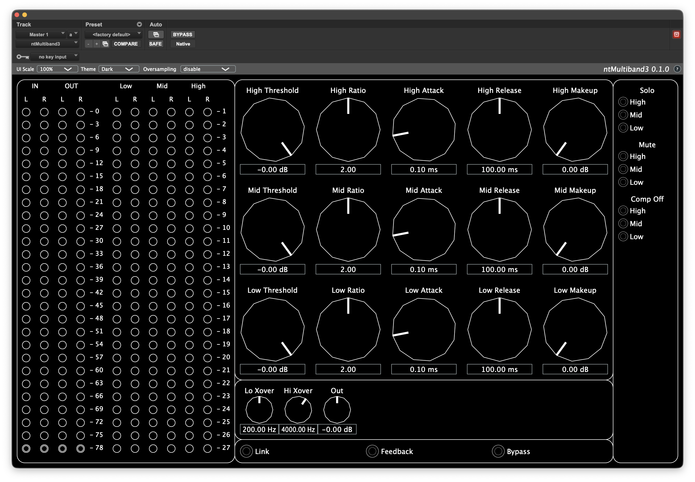

# ntMultiband3 Manual

ntMultiband3 is a three band multiband compressor with first order crossovers
and linear domains side chains with feedback or feed forward modes and a fixed
12dB knee.

The image above displays the UI of the plugin. The main grid contains the well
knows compressor controls for each band, below that are the controls for cross
over frequencies and output trim and below that are three toggles; **Link**,
**Feedback** and **Bypass**.

## Primary Controls

Each band in the main grid has the following controls:

- **Threshold** controls the level at which compression sets in for each band.
- **Ratio** controls the amount of the level above **Threshold** is being
  reduced.
- **Attack** controls how fast the compressor applies gain reduction.
- **Release** controls how fast the compressor recovers after the signal falls
  below **Threshold**.
- **Makeup** applies gain to the signal in order to make up for the reduction of
  level in the band.

## Secondary Controls

Secondary controls are placed below the main grid and includes:

- **Lo Xover** controls the frequency at which the signal is split between the
  low and mid frequency bands.
- **Hi Xover** controls the frequency at which the signal is split between mid
  and high frequency bands.
- **Out** controls the over all output level of the plugin.

## Toggles

Three toggles are placed in the bottom of the UI. These include:

- **Link** links left and right channels so that the sound image is kept
  centered when one channel compresses more than another.
- **Feedback** feeds the output of each band to the input of that band's side
  chain as opposed to using the input. This reduces the amount of compression
  and makes it more smooth/old school sounding. This is a general setting for
  all bands.
- **Bypass** bypasses processing and sends the input of the plugin straight to
  the output.

To the right of the UI is placed a number of toggles for each band. These
include:

- **Solo** mute the other bands so one band can be heard in isolation.
- **Mute** mutes the selected band.
- **Comp Off** disables compression for the selected band.
