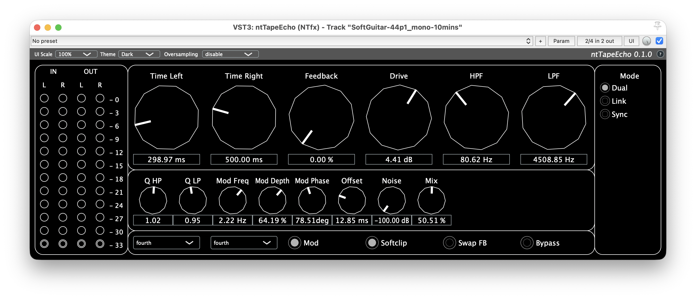

# ntTapeEcho Manual

ntTapeEcho is a modulating delay effect with 2nd order high and low pass filters
and 3rd order soft clipping in the feed forward path. Modulation is sinusoid and
uses an intersample delay line for smooth operation.

## Overview

## Controls

The plugin has the following controls.

### Mode

There are three modes:

- **Dual** mode allows separate control over the delay time for each channel.
- **Link** mode links the right side delay time to the left, allowing relative
  adjustment based on both subdevission and direct offset in delay time between
  channels.
- **Sync** mode links delay time to the host tempo.

### Time Left

Sets the delay time for the left channel in milliseconds.

### Time Right

Sets the delay time for the right channel in milliseconds.

### Feedback

Controls the feedback level of the channel with the shortest delay time.
Feedback for channel with the longest delay time will be calculated from this in
order to always match the reverberation of the two channels. This means that
this parameter does not behave exactly as one might expect.

### Drive

Controls the gain of the soft clipper, which is gain matched on the output.

### HPF

Controls the frequency of the high pass filter.

### LPF

Controls the frequency of the low pass fitler.

### Q HP and Q LP

Controls the Q of the high- and low pass filters respectively. A Q above 0.707
is underdampened, adding to the feedback at the selected cutoff frequency. It
gets dirty.

### Modulation Controls

The three mosdulation controls are placed to the right of the two Q controls.

- Mod Freq controls the frequency of the modulation.
- Mod Depth controls the amount of modulation.
- Mod Phase controls the phase offset of the modulation frequency between left
  and tight side. Set to 0 for mono modulation.

### Offset

The offset control adds extra delay time to the right side delay time for stereo
spread.

### Noise

Adds band limited pink noise to the signal for a realistic tape effect.

### Mix

Fades from dry, unprocessed to wet, processed signal.
