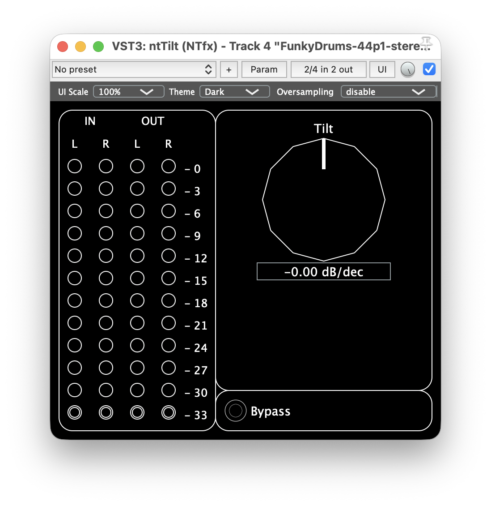
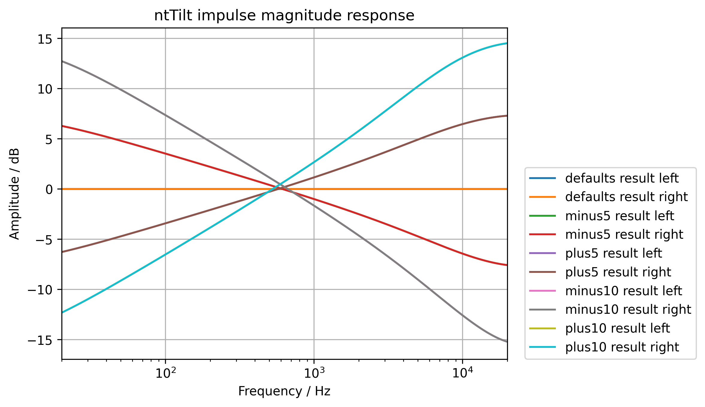

# ntTilt Manual

ntTilt is a tilting EQ, dilivering a linear, tilted frequency response from -10
to +10 dB/decade. Negative tilt is darker, positive is brighter.

The plot below displays the frequency response at varying settings from -10 to
+10 dB/decade. As shown a tilt of 10 dB/decade equates to a 30 dB difference
over the audio spectrum.

